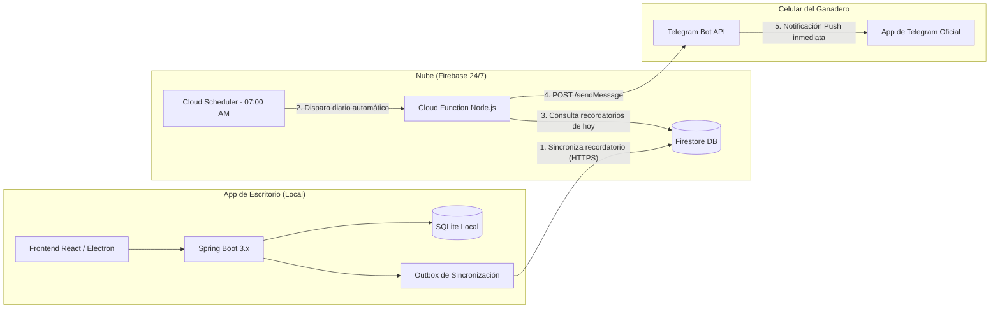

# Plan de Implementación: Sistema de Notificaciones Relay Cloud (Firebase + Telegram Bot 24/7)

Este documento describe la arquitectura, diseño técnico, estructura de datos y pasos de implementación para el sistema de notificaciones de **GANADERO** utilizando **Firebase Firestore + Cloud Functions + Telegram Bot API**.

Esta solución garantiza que el ganadero reciba alertas de **Sanidad (vacunas, desparasitaciones)** y **Reproducción (celos, partos proyectados)** en su celular a la hora exacta **sin necesidad de programar una aplicación móvil nativa y funcionando aunque la computadora de escritorio esté apagada**.

---

## 1. Visión General de la Arquitectura



### 1.1. Ventajas Clave de este Enfoque
1. **Sin desarrollo de App Móvil:** El ganadero utiliza la aplicación oficial de Telegram que ya existe en Play Store y App Store.
2. **PC Apagada:** Al guardar el evento en la app de escritorio, este se sube a Firestore. La Cloud Function en la nube se encarga de enviar el mensaje a la hora programada, incluso si la PC pasa semanas apagada.
3. **Costo $0.00:** Tanto el nivel gratuito de Firebase (Firestore + Functions) como la API de Telegram son 100% gratuitos.
4. **Múltiples destinatarios:** Puede enviar la misma alerta al dueño, al veterinario y al capataz al mismo tiempo configurando sus respectivos `Chat IDs`.

---

## 2. Componentes del Sistema

| Componente | Rol | Tecnología |
| :--- | :--- | :--- |
| **Backend Desktop** | Genera eventos, calcula fechas de vencimiento y sincroniza recordatorios al guardar en local. | Spring Boot 3.x (Java 21) + SQLite |
| **Outbox Local** | Cola local en SQLite para reintentar sincronizaciones si al registrar no hay internet. | Tabla SQLite `outbox_alerta_cloud` |
| **Relay Database (Nube)** | Almacena los recordatorios programados y la configuración de Telegram. | Google Cloud Firestore |
| **Despachador Programado** | Tarea cron en la nube que busca vencimientos y envía mensajes a Telegram. | Firebase Cloud Functions v2 + Cloud Scheduler |
| **Canal de Entrega** | Recibe el mensaje con sonido y vibración en el teléfono. | Telegram Bot API |

---

## 3. Estructura de Datos en Firestore

Solo viajan a la nube los datos necesarios para el recordatorio, manteniendo la privacidad de la base de datos local.

### 3.1. Colección: `recordatorios`
Document ID: UUID generado por el Desktop.

```json
{
  "id": "rec-550e8400-e29b-41d4-a716-446655440000",
  "cuenta_id": "granja_el_trebol",
  "tipo_modulo": "REPRODUCCION",      // SANIDAD | REPRODUCCION | TRATAMIENTO | GENERAL
  "subtipo": "PARTO_PROYECTADO",       // VACUNACION | DESPARASITACION | CELO | PALPACION | SECADO
  "animal_codigo": "VACA-1042",
  "titulo": "🐮 Parto Próximo: Vaca #1042",
  "mensaje": "La vaca #1042 cumple 283 días de gestación. Preparar corral de maternidad.",
  "fecha_programada": "2026-11-20T08:00:00Z",
  "dias_anticipacion": 3,
  "prioridad": "ALTA",               // BAJA | MEDIA | ALTA | URGENTE
  "estado": "PENDIENTE",             // PENDIENTE | ENVIADO | CANCELADO
  "creado_en": "2026-10-06T14:50:00Z",
  "enviado_en": null,
  "metadata": {
    "lote": "Lote Reproductoras 2"
  }
}
```

### 3.2. Colección: `configuracion_telegram`
Almacena los chats o grupos de Telegram donde se deben enviar las alertas de cada granja.

```json
{
  "cuenta_id": "granja_el_trebol",
  "bot_token": "7123456789:AAHxyz...",
  "chat_ids": [
    {
      "chat_id": "123456789",
      "nombre": "Juan Pérez (Administrador)",
      "activo": true
    },
    {
      "chat_id": "-100987654321",
      "nombre": "Grupo Veterinarios y Capataces",
      "activo": true
    }
  ]
}
```

---

## 4. Fases de Implementación

---

### FASE 1: Creación del Bot de Telegram y Proyecto Firebase

#### 1.1. Crear el Bot en Telegram (2 minutos)
1. En la app de Telegram, busca al usuario oficial **`@BotFather`**.
2. Envía el comando `/newbot`.
3. Sigue las instrucciones y asígnale un nombre (ej. `GanaderoAlertasBot`).
4. `@BotFather` te entregará un **HTTP API Token** (ej. `7123456789:AAFxxx...`). Guarda este token.
5. El ganadero o veterinario inicia una conversación con el bot enviándole `/start` y obtiene su `Chat ID` (puedes usar el bot `@userinfobot` para ver el ID de usuario o de grupo).

#### 1.2. Configurar Firebase y Firestore
1. Entrar a [Firebase Console](https://console.firebase.google.com/) y crear un proyecto (ej: `ganadero-relay-cloud`).
2. Activar **Cloud Firestore** en modo producción.
3. En *Configuración del Proyecto > Cuentas de Servicio*, descargar la clave privada en formato JSON (`firebase-service-account.json`).

---

### FASE 2: Backend Desktop (Spring Boot + SQLite)

#### 2.1. Dependencias Maven
En `backend/pom.xml`:
```xml
<dependency>
    <groupId>com.google.firebase</groupId>
    <artifactId>firebase-admin</artifactId>
    <version>9.3.0</version>
</dependency>
```

#### 2.2. Migración Flyway: Tabla de Outbox Local
En `backend/src/main/resources/db/migration/V0XX__crear_tabla_outbox_alerta.sql`:
```sql
CREATE TABLE IF NOT EXISTS outbox_alerta_cloud (
    id TEXT PRIMARY KEY,
    cuenta_id TEXT NOT NULL,
    tipo_modulo TEXT NOT NULL,
    subtipo TEXT NOT NULL,
    animal_codigo TEXT NOT NULL,
    titulo TEXT NOT NULL,
    mensaje TEXT NOT NULL,
    fecha_programada TEXT NOT NULL,
    prioridad TEXT NOT NULL DEFAULT 'MEDIA',
    estado_sincronizacion TEXT NOT NULL DEFAULT 'PENDIENTE_SUBIDA', -- PENDIENTE_SUBIDA | SINCRONIZADO | PENDIENTE_CANCELACION
    intentos INTEGER NOT NULL DEFAULT 0,
    creado_en TEXT NOT NULL,
    sincronizado_en TEXT
);

CREATE INDEX IF NOT EXISTS idx_outbox_estado ON outbox_alerta_cloud(estado_sincronizacion);
```

#### 2.3. Servicio de Sincronización en Spring Boot
```java
@Service
@Slf4j
@RequiredArgsConstructor
public class FirebaseRelaySyncService {

    private final OutboxAlertaRepository outboxRepository;
    private final Firestore firestoreClient;

    // Intenta sincronizar cada 1 minuto en segundo plano
    @Scheduled(fixedDelay = 60000)
    public void procesarOutboxPendientes() {
        List<OutboxAlerta> pendientes = outboxRepository.findByEstado("PENDIENTE_SUBIDA");
        if (pendientes.isEmpty()) return;

        for (OutboxAlerta alerta : pendientes) {
            try {
                Map<String, Object> doc = new HashMap<>();
                doc.put("id", alerta.getId());
                doc.put("cuenta_id", alerta.getCuentaId());
                doc.put("tipo_modulo", alerta.getTipoModulo());
                doc.put("subtipo", alerta.getSubtipo());
                doc.put("animal_codigo", alerta.getAnimalCodigo());
                doc.put("titulo", alerta.getTitulo());
                doc.put("mensaje", alerta.getMensaje());
                doc.put("fecha_programada", alerta.getFechaProgramada().toString());
                doc.put("estado", "PENDIENTE");
                doc.put("creado_en", Instant.now().toString());

                firestoreClient.collection("recordatorios")
                        .document(alerta.getId())
                        .set(doc)
                        .get();

                alerta.setEstadoSincronizacion("SINCRONIZADO");
                alerta.setSincronizadoEn(LocalDateTime.now());
                outboxRepository.save(alerta);
                log.info("Recordatorio sincronizado con Firebase Relay: {}", alerta.getId());
            } catch (Exception e) {
                log.warn("Sin internet o error al sincronizar con Firebase: {}", e.getMessage());
                alerta.incrementarIntentos();
                outboxRepository.save(alerta);
                break;
            }
        }
    }
}
```

---

### FASE 3: Cloud Function en Firebase (Despachador a Telegram 24/7)

Esta función corre en los servidores de Google y se encarga de enviar los mensajes de Telegram puntualmente.

**Archivo `functions/src/index.ts`:**
```typescript
import * as functions from "firebase-functions/v2";
import * as admin from "firebase-admin";

admin.initializeApp();
const db = admin.firestore();

// Programado para ejecutarse todos los días a las 07:00 AM (Zona horaria local)
export const despachadorTelegramGanadero = functions.scheduler.onSchedule(
  { schedule: "0 7 * * *", timeZone: "America/La_Paz" },
  async (event) => {
    const ahoraIso = new Date().toISOString();

    // 1. Obtener recordatorios pendientes con fecha programada menor o igual a hoy
    const snapshot = await db.collection("recordatorios")
      .where("estado", "==", "PENDIENTE")
      .where("fecha_programada", "<=", ahoraIso)
      .get();

    if (snapshot.empty) {
      console.log("No hay recordatorios pendientes para enviar.");
      return;
    }

    for (const doc of snapshot.docs) {
      const rec = doc.data();

      // 2. Obtener configuración de Telegram para esta cuenta
      const configDoc = await db.collection("configuracion_telegram")
        .doc(rec.cuenta_id)
        .get();

      if (!configDoc.exists) {
        console.warn(`No hay configuración de Telegram para cuenta: ${rec.cuenta_id}`);
        continue;
      }

      const config = configDoc.data()!;
      const botToken = config.bot_token;
      const chatIds: string[] = (config.chat_ids || [])
        .filter((c: any) => c.activo)
        .map((c: any) => c.chat_id);

      // 3. Formatear mensaje con formato Markdown de Telegram
      const textoMensaje = 
`*${rec.titulo}*

📅 *Fecha:* ${new Date(rec.fecha_programada).toLocaleDateString("es-ES")}
🏷 *Animal:* \`${rec.animal_codigo}\`
📋 *Módulo:* ${rec.tipo_modulo} (${rec.subtipo})

${rec.mensaje}

_Sistema GANADERO Desktop_`;

      // 4. Enviar a cada destinatario configurado
      for (const chatId of chatIds) {
        try {
          const url = `https://api.telegram.org/bot${botToken}/sendMessage`;
          await fetch(url, {
            method: "POST",
            headers: { "Content-Type": "application/json" },
            body: JSON.stringify({
              chat_id: chatId,
              text: textoMensaje,
              parse_mode: "Markdown",
            }),
          });
          console.log(`Alerta enviada a Telegram Chat ID ${chatId} para recordatorio ${rec.id}`);
        } catch (err) {
          console.error(`Error enviando a Telegram chat ${chatId}:`, err);
        }
      }

      // 5. Marcar como ENVIADO
      await doc.ref.update({
        estado: "ENVIADO",
        enviado_en: new Date().toISOString(),
      });
    }
  }
);
```

---

## 5. Experiencia de Usuario (UI de Escritorio)

En el frontend de **GANADERO (React + Electron)**, se agrega una sección en **Configuración > Notificaciones Telegram**:

1. **Campos de configuración:**
   - Token del Bot de Telegram (o token global preconfigurado).
   - Lista de `Chat IDs` agregados (con botón *"Probar Notificación"* para verificar que el celular suene en ese instante).
2. **Ejemplo de mensaje recibido en el celular:**

```text
🐮 Parto Próximo: Vaca #1042

📅 Fecha: 20/11/2026
🏷 Animal: VACA-1042
📋 Módulo: REPRODUCCION (PARTO_PROYECTADO)

La vaca #1042 cumple 283 días de gestación. Preparar corral de maternidad.

Sistema GANADERO Desktop
```

---

## 6. Estimación de Costos

| Servicio | Concepto | Costo Mensual |
| :--- | :--- | :---: |
| **Telegram Bot API** | Mensajes ilimitados a cualquier número de chats | **$0.00 (Gratis)** |
| **Firebase Firestore** | Base de datos para recordatorios (< 50,000 lecturas/día) | **$0.00 (Gratis)** |
| **Firebase Cloud Functions** | Ejecución diaria de cron (30 invocaciones al mes) | **$0.00 (Gratis)** |
| **Desarrollo y Mantenimiento** | Cero mantenimiento de apps móviles en Play Store/App Store | **$0.00** |

---

## 7. Lista de Verificación (Checklist)

- [ ] Crear el bot de Telegram en `@BotFather` y copiar el token.
- [ ] Crear proyecto en Firebase Console y habilitar Firestore.
- [ ] Aplicar la migración Flyway de `outbox_alerta_cloud` en Spring Boot.
- [ ] Conectar los eventos de creación de Sanidad (vacunas) y Reproducción (inseminación/parto) con el Outbox.
- [ ] Desplegar la Cloud Function `despachadorTelegramGanadero` en Firebase.
- [ ] Probar envío inmediato desde la app de escritorio hacia el celular.
- [ ] Prueba de apagado: Registrar un recordatorio $\rightarrow$ apagar la PC $\rightarrow$ verificar que el mensaje llegue puntualmente a las 07:00 AM.
